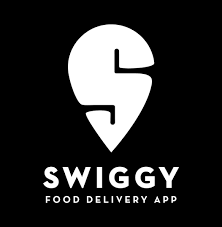
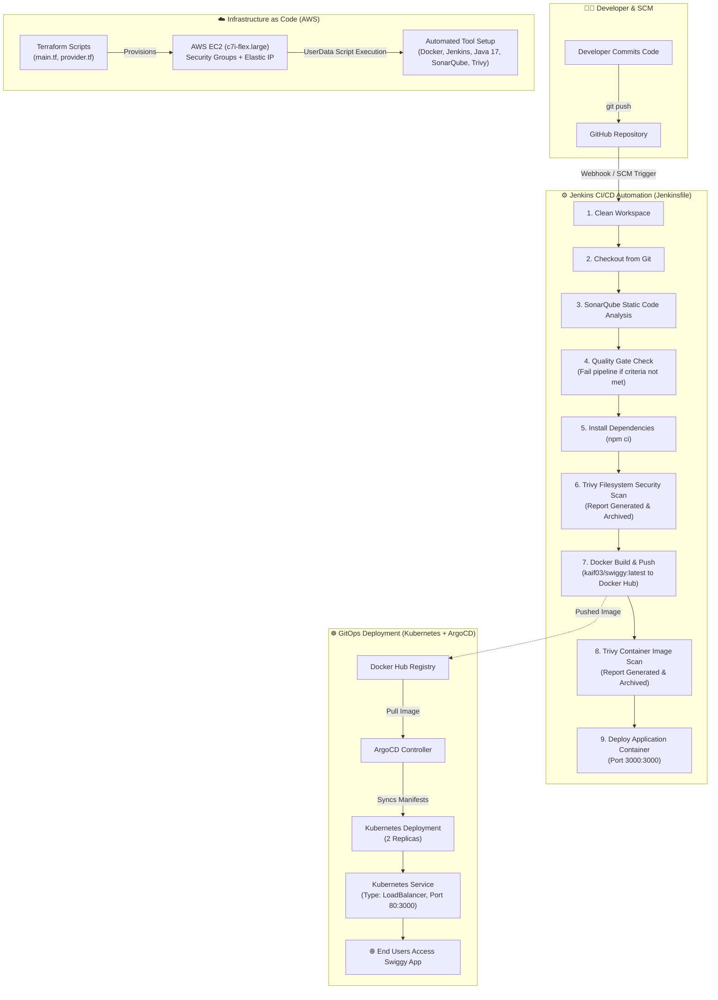

<div align="center">

  

  # 🚀 End-to-End DevSecOps CI/CD Pipeline: Swiggy Clone

  **Production-Ready Cloud Infrastructure, Shift-Left Security, Continuous Integration & GitOps Deployment**

  [](https://aws.amazon.com/)
  [](https://www.terraform.io/)
  [](https://www.jenkins.io/)
  [](https://www.docker.com/)
  [](https://www.sonarqube.org/)
  [](https://aquasecurity.github.io/trivy/)
  [](https://kubernetes.io/)
  [](https://argo-cd.readthedocs.io/)
  [](https://reactjs.org/)

</div>

---

## 📌 Project Overview

This project showcases an enterprise-grade **DevSecOps Pipeline** for a full-stack **Swiggy Clone** React web application. The core objective is implementing true **Shift-Left Security** and continuous delivery—automating infrastructure provisioning on AWS with Terraform, orchestrating automated CI/CD workflows via Jenkins, integrating static code quality analysis and vulnerability scans at multiple checkpoints, and deploying containerized workloads with Docker and Kubernetes (via ArgoCD GitOps).

---

## 🏗️ Architecture & Pipeline Workflow



---

## 🛠️ Tech Stack & DevSecOps Tools

| Category | Tool | Purpose in this Project |
| :--- | :--- | :--- |
| **Cloud Provider** | **AWS (ap-south-1)** | Hosted the computing infrastructure (EC2, Elastic IP, Security Groups, VPC). |
| **Infrastructure as Code** | **Terraform** | Automated provisioning of AWS EC2 `c7i-flex.large` with 30GB gp3 storage and network rules. |
| **Version Control** | **Git & GitHub** | Source code management and CI/CD webhook integration. |
| **CI/CD Automation** | **Jenkins** | Declarative pipeline orchestrating code checkout, testing, security scans, build, and deployment. |
| **Static Code Analysis (SAST)** | **SonarQube & SonarScanner** | Analyzed code quality, code smells, duplicate lines, test coverage, and enforced Quality Gates. |
| **Vulnerability Scanning** | **Trivy** | Shift-left security scanner inspecting dependencies on the filesystem and scanning Docker images for CVEs. |
| **Containerization** | **Docker & Docker Hub** | Multi-step container build and image registry management (`kaif03/swiggy`). |
| **GitOps & Orchestration** | **ArgoCD & Kubernetes** | Declarative GitOps deployment with 2 replicas and automated LoadBalancer routing. |
| **Application Layer** | **React.js & Bootstrap** | Responsive frontend simulating Swiggy food delivery experience. |

---

## 🌟 What I Did in This Project

### 1. Automated Infrastructure with Terraform (IaC)
- Designed and executed Terraform configuration files ([`main.tf`](main.tf), [`provider.tf`](provider.tf)) targeting AWS `ap-south-1`.
- Configured a dedicated AWS Security Group (`Terraform-SG`) defining explicit ingress rules for essential service ports:
  - **Port 22:** Secure SSH administrative access.
  - **Port 80:** HTTP web traffic.
  - **Port 443:** Secure HTTPS web traffic.
  - **Port 8080:** Jenkins automation server.
  - **Port 9000:** SonarQube dashboard.
  - **Port 3000:** Swiggy application container.
- Configured an AWS EC2 instance (`c7i-flex.large`) with a 30 GB gp3 root EBS volume to comfortably accommodate Jenkins, Docker builds, and containerized SonarQube.
- Attached a static Elastic IP (`13.203.5.121`) ensuring persistent addressability.
- Embedded a User Data bootstrapping script ([`resource.sh`](resource.sh) / [`install.sh`](install.sh)) that runs automatically on EC2 startup.

---

### 2. Automated Server Provisioning & Tool Configuration
Automated the installation and startup of all required DevSecOps tooling via a bash startup script:
- **Adoptium Temurin OpenJDK 17:** Installed LTS JDK required by Jenkins and SonarQube.
- **Jenkins:** Configured the official Debian/Ubuntu repository, installed the latest stable Jenkins release, and configured the systemd service.
- **Docker Engine:** Installed `docker.io`, added the `ubuntu` user to the `docker` group, and adjusted socket permissions for Jenkins daemon access.
- **SonarQube Server:** Spun up an isolated SonarQube container on port `9000:9000` using `sonarqube:lts-community`.
- **Aqua Security Trivy:** Installed the official Trivy security scanner CLI for filesystem and container vulnerability scans.

---

### 3. Comprehensive Jenkins CI/CD Pipeline ([`Jenkinsfile`](Jenkinsfile))
Implemented an end-to-end declarative pipeline consisting of 9 distinct stages:

```groovy
pipeline {
    agent any
    tools {
        jdk 'jdk17'
        nodejs 'node20'
    }
    environment {
        JAVA_HOME    = '/usr/lib/jvm/temurin-17-jdk-amd64'
        SCANNER_HOME = tool 'sonar-scanner'
        DOCKER_IMAGE = 'kaif03/swiggy'
        DOCKER_TAG   = 'latest'
    }
    ...
```

1. **Clean Workspace:** Invokes `cleanWs()` to ensure no residual artifacts contaminate the build.
2. **Checkout from Git:** Clones the latest branch from `https://github.com/kaif2104/DevSecops-swiggy-clone.git`.
3. **SonarQube Code Analysis:** Invokes `sonar-scanner` pointing to `sonar-server` analyzing source files for code smells, vulnerabilities, and technical debt.
4. **Quality Gate:** Utilizes `waitForQualityGate` (with a 5-minute timeout) to halt the pipeline immediately if code fails project quality gates.
5. **Install Dependencies:** Executes `npm ci` for fast, deterministic, and clean Node.js package installations.
6. **Trivy Filesystem Security Scan:** Scans the project repository for `HIGH` and `CRITICAL` vulnerabilities and outputs a structured report (`trivy-fs-report.txt`) that gets archived in Jenkins.
7. **Docker Build & Push:** Authenticates securely with Docker Hub using Jenkins credentials (`docker-creds`), builds the Docker image, and tags/pushes `kaif03/swiggy:latest`.
8. **Trivy Image Vulnerability Scan:** Scans the freshly generated Docker image before deployment, generating and archiving `trivy-image-report.txt`.
9. **Deploy to Container:** Safely stops any existing container and launches the new release on port `3000:3000`.

---

### 4. Containerization with Docker ([`Dockerfile`](Dockerfile))
Constructed an optimized Docker image for the React application:
- Base image: `node:16`
- Working directory: `/app`
- Leveraged layer caching by copying `package*.json` prior to copying application source code.
- Compiled the production build with `npm run build`.
- Exposed application port `3000` with container launch command `npm start`.

---

### 5. GitOps & Cloud-Native Deployment with Kubernetes & ArgoCD ([`ArgoCD/`](ArgoCD/))
Prepared the project for production-grade Kubernetes orchestration:
- **Deployment Manifest ([`ArgoCD/deployment.yml`](ArgoCD/deployment.yml)):**
  - Manages `swiggy-app` deployment with `replicas: 2`.
  - Configured rolling updates with 30-second graceful termination.
  - Pulls image `kaif03/swiggy:latest` with `imagePullPolicy: Always`.
- **Service Manifest ([`ArgoCD/service.yml`](ArgoCD/service.yml)):**
  - Configures a `LoadBalancer` service type.
  - Maps port `80` (public HTTP) to container `targetPort: 3000`.
- **ArgoCD GitOps Sync:** Allows ArgoCD to monitor the Git repository and automatically reconcile the desired cluster state with the live state.

---

## 🔒 DevSecOps & Security Enforcement Summary

```
                      SHIFT-LEFT DEVSECOPS
 [Code] ──> [SonarQube SAST] ──> [Trivy Filesystem Scan]
                                          │
                                          ▼
[Deploy] <── [Trivy Image Scan] <── [Docker Build]
```

- **SAST (Static Application Security Testing):** SonarQube analyzes source code before compilation, blocking low-quality code via strict Quality Gates.
- **SCA & Dependency Vulnerability Scanning:** Trivy scans `node_modules` and filesystem dependencies for known CVEs.
- **Container Security Scanning:** Trivy scans the final image layers for operating system and binary vulnerabilities before deployment.
- **Least-Privilege Security Group Rules:** Restricts incoming traffic to required operational ports on AWS.

---

## 📂 Project Directory Structure

```text
.
├── ArgoCD/
│   ├── deployment.yml         # Kubernetes deployment manifest (2 replicas)
│   ├── service.yml            # Kubernetes LoadBalancer service manifest
│   └── README.md
├── Photos/
│   └── images.png             # Swiggy application branding logo
├── src/                       # React frontend source code
│   ├── Components/            # UI Components (Offers, Restaurant Chains, Navigation)
│   ├── Photos/                # Component image assets
│   ├── App.js                 # Root React component
│   └── index.js               # Application entrypoint
├── Dockerfile                 # Docker containerization configuration
├── Jenkinsfile                # Declarative 9-stage DevSecOps CI/CD pipeline
├── install.sh                 # Standalone shell script for host dependencies
├── resource.sh                # User-data script executed by Terraform on EC2
├── main.tf                    # Terraform AWS infrastructure resources
├── provider.tf                # Terraform AWS provider specification
├── package.json               # Node.js project manifest & dependencies
└── README.md                  # Project documentation
```

---

## 🚀 Getting Started & Execution Guide

### Prerequisites
- AWS Account with programmatic access configured via AWS CLI (`aws configure`).
- Terraform CLI (`>= 1.5.0`) installed.
- Git, Node.js (`>= 18`), and Docker installed locally for local testing.

---

### Step 1: Provision Infrastructure with Terraform
```bash
# Initialize Terraform and download AWS provider
terraform init

# Validate configuration syntax
terraform validate

# Review proposed changes
terraform plan

# Apply infrastructure provisioning
terraform apply -auto-approve
```

---

### Step 2: Jenkins Credentials & Tool Setup
Once the EC2 instance is up, navigate to Jenkins (`http://<EC2_PUBLIC_IP>:8080`) and complete initial setup:
1. **Manage Jenkins > Tools**:
   - Add **JDK**: Name `jdk17`, path `/usr/lib/jvm/temurin-17-jdk-amd64`
   - Add **NodeJS**: Name `node20`
   - Add **SonarScanner**: Name `sonar-scanner`
2. **Manage Jenkins > Credentials**:
   - Add `docker-creds` (Username & Password for Docker Hub)
   - Add `sonar-token` (Secret text for SonarQube integration)
3. **Configure System > SonarQube servers**:
   - Name: `sonar-server`
   - Server URL: `http://<EC2_PUBLIC_IP>:9000`

---

### Step 3: Run the Pipeline
1. Create a new **Pipeline** job in Jenkins named `Swiggy-DevSecOps`.
2. Set definition to **Pipeline script from SCM** pointing to:
   - Repository URL: `https://github.com/kaif2104/DevSecops-swiggy-clone.git`
   - Branch: `*/main`
   - Script Path: `Jenkinsfile`
3. Click **Build Now** to trigger the pipeline.
4. Verify each stage passes successfully:
   - ✅ SonarQube Quality Gate passed
   - ✅ Trivy filesystem security report generated
   - ✅ Docker image built and pushed to Docker Hub
   - ✅ Trivy image vulnerability report generated
   - ✅ Docker container running on port 3000

---

### Step 4: Deploying to Kubernetes with ArgoCD
```bash
# Apply Kubernetes manifests manually or let ArgoCD sync them:
kubectl apply -f ArgoCD/deployment.yml
kubectl apply -f ArgoCD/service.yml

# Check deployment status
kubectl get pods -l app=swiggy-app
kubectl get svc swiggy-app
```

Access the application in your browser at `http://<LoadBalancer-IP>` or `http://<EC2-IP>:3000`.

---

## 👤 Author

**Mohammed Kaif Dudhwala**  
- **GitHub:** [@kaif2104](https://github.com/kaif2104)  
- **Docker Hub:** [kaif03](https://hub.docker.com/u/kaif03)  

---

<div align="center">
  <sub>Built with ❤️ as a real-time hands-on DevSecOps implementation.</sub>
</div>
